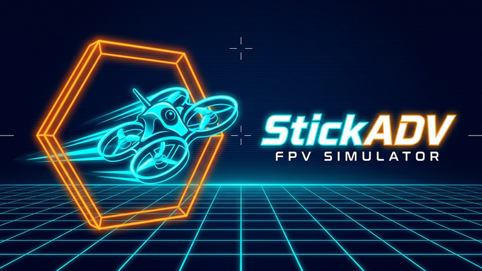

# StickADV



**StickADV** is a 60 FPS, full-color 3D FPV racing simulator for the **M5Stack Cardputer-Adv** (`ESP32-S3FN8`, 240×135 ST7789V2, BMI270 IMU, ES8311 audio), faithfully ported from Alexey Stankevich's classic EdgeTX/OpenTX `Game-simulator.lua` and upgraded with an authentic **Betaflight Analog OSD (MAX7456 style)** and tri-mode low-latency radio controller input.

## Highlights

- **Faithful EdgeTX Game-Simulator Gameplay**: 3-2-1-GO countdown, 30-second timed race (plus Endless Free-Flight mode), 4 obstacle types (`gateGround`, `gateAir`, `flagLeft`, `flagRight`), next-target guidance reticle & off-screen chevron, authentic EdgeTX tones + Betaflight ESC arming jingle, and persistent NVS high-score tracking.
- **Full-Color 60 FPS 3D FPV Engine**: Direct RGB565 software rasterizer into a 64.8 KB DMA-ready `M5Canvas` sprite (no PSRAM required), featuring a rolling/pitching sky & grass horizon, perspective ground speed grid, red/white checkered racing corridor curbs, depth-sorted colorful 3D gates & flags, and toggleable analog CRT scanlines + 5.8 GHz RF static glitches.
- **Authentic Betaflight Analog OSD**: Custom crisp MAX7456-style black-outlined bitmap typography & pixel icons (`LQ/RSSI`, live score/best, countdown timer, airspeed, altitude, tilting Artificial Horizon + crosshair + sidebars, 4S LiPo sag voltage or real Cardputer battery voltage, throttle %, flight mode, craft name, and Betaflight Post-Flight Stats screen).
- **Tri-Mode Zero-Lag Controls** (automatic seamless failover):
  1. **USB-OTG EdgeTX Radio Controller** *(Priority 1, ~1–4 ms)*: ESP32-S3 native USB Host (`usb/usb_host.h`) on Core 0 supporting EdgeTX Classic (19 B), EdgeTX 2.11+ Standard (20 B), EdgeTX Advanced custom HID descriptors (`VID 1209 / PID 4F54`), and generic USB HID joysticks.
  2. **Bluetooth Low Energy (BLE) ExpressLRS / HID Radio** *(Priority 2, ~7.5 ms / 133 Hz)*: `NimBLE-Arduino` Central on Core 0 using minimum BLE 5.0 connection interval (`min=6, max=6, latency=0`) and push notifications (`0x2A4D`) with automatic **ExpressLRS BLE Joystick** (`"ELRS Joystick"`) axis remapping (`X, Y, Rx, Ry, Z, Rz`). Scanning automatically pauses during active flight so there is zero RF jitter.
  3. **Internal BMI270 6-Axis IMU + Keyboard** *(Priority 3, instant fallback)*: Complementary accel+gyro fusion for snappy tilt flying, one-key comfortable viewing-angle zeroing (`C`), and smooth keyboard altitude control with optional Alt-Hold hover assist.

## Why C++17 (PlatformIO / ESP-IDF + Arduino) instead of Rust or Lua?

- **Performance**: Both C++ and Rust compile to native 240 MHz Xtensa LX7 machine code with hardware FPU — rendering 240×135 RGB565 + Betaflight OSD + SPI DMA hits a rock-solid **60 FPS** with Core 0 dedicated to USB/BLE I/O. (Lua would be significantly slower and lacks USB-OTG Host HID access.)
- **Cardputer-Adv Hardware Maturity**: First-party `M5Cardputer` / `M5Unified` / `M5GFX` drivers handle Cardputer-Adv's **TCA8418** I²C keyboard, **BMI270** IMU (including the 8 KB Bosch config blob), **ES8311** audio codec, and **ST7789V2** DMA SPI out of the box, paired directly with ESP-IDF's production `usb/usb_host.h` and `NimBLE` stacks.

## Controls

### Global & Menu Keys
| Key | Action |
|---|---|
| `Enter` / `G0` (`BtnA`) / EdgeTX `ARM` (`CH5` or `Btn1`) | Arm & Start / Restart Run |
| `Del` / `` ` `` (ESC) | Abort Run / Back |
| `C` | Zero / Calibrate BMI270 IMU to current holding angle |
| `B` | Toggle BLE Scan / Disconnect BLE Radio |
| `M` / `Tab` | Open Betaflight OSD CMS Settings Menu |
| `K` | Open Live 8-Channel Stick & IMU Monitor |

### IMU + Keyboard Flight (when no USB/BLE radio is connected)
| Input | Action |
|---|---|
| **Tilt Left / Right** (or `A`/`D`, `,`/`/`) | Roll (move left / right + camera bank) |
| **Tilt Forward / Back** (or `E`/`Q`) | Pitch (accelerate forward / slow down) |
| **`W` / `;` (Up) / `Space`** | Throttle Up (climb) |
| **`S` / `.` (Down) / `Shift`** | Throttle Down (descend) |

*(With `IMU ALT HLD = ON` in Settings, releasing throttle keys smoothly hovers at your current altitude.)*

## Connecting an EdgeTX / ExpressLRS Radio

### Option A: Wireless via ExpressLRS BLE Joystick (Recommended — Zero Cable!)
1. On your EdgeTX radio, open `SYS` → **ExpressLRS** Lua script → **BLE Joystick**.
2. On the Cardputer-Adv Title screen, press **`B`** (or open `[M] SETUP → BLE RADIO → SCAN NOW`).
3. The Cardputer-Adv connects to `"ELRS Joystick"` at a **7.5 ms** BLE interval (133 Hz) and automatically applies ExpressLRS's channel order. Open **`K` (Stick Monitor)** to verify all channels live.

### Option B: Wired via USB-C OTG (EdgeTX USB Joystick HID)
1. Power on the Cardputer-Adv via its side power switch.
2. Connect your EdgeTX radio to the Cardputer-Adv USB-C port using a **USB-C OTG cable** (or a **powered USB-C OTG hub / Y-splitter** if your EdgeTX radio requires 5 V on VBUS to display the USB mode prompt — the Stamp-S3A does not include an internal 5 V VBUS boost converter).
3. Select **USB Joystick (HID)** on your EdgeTX radio. The OSD automatically switches to `USB:99`.
4. Choose your transmitter channel order (`AETR`, `TAER`, or `AERT`) in **`[M] SETUP → CH MAPPING`**.

## Pre-Built Firmware (`dist/`)

Ready-to-flash ESP32-S3 binaries for **M5Stack Cardputer-Adv** are included in `dist/`:

- **[`dist/stickadv.bin`](dist/stickadv.bin)** *(App binary — recommended for **M5Launcher**)*: Copy to your microSD card (or upload via M5Launcher WebUI / OTA) and install directly without overwriting M5Launcher or NVS settings. Also flashable via `esptool` at offset `0x10000`.
- **[`dist/stickadv-merged.bin`](dist/stickadv-merged.bin)** *(Full merged image — for **M5Burner** / standalone flash)*: Complete `0x0000` image (bootloader + partition table + `boot_app0` + app) ready to publish/flash with **M5Burner** or `esptool.py --chip esp32s3 write_flash 0x0 dist/stickadv-merged.bin` (also recognized by M5Launcher).
- **[`assets/cover.png`](assets/cover.png)**: 800×450 M5Burner / M5Launcher cover image.

## Building & Flashing

### Prerequisites
- [PlatformIO CLI](https://platformio.org/) (`pio`) or VS Code + PlatformIO IDE extension.

### Build Firmware
```bash
pio run -e cardputer-adv
```

### Flash to Cardputer-Adv
Because the firmware claims the ESP32-S3 native USB-OTG PHY for USB Host mode (`ARDUINO_USB_CDC_ON_BOOT=0`), put the Cardputer-Adv into **ROM Download Mode** before flashing:
1. Slide the side power switch to **OFF**.
2. Press and hold the **`G0`** button (top-left).
3. Plug the USB-C data cable into your PC, then release **`G0`**.
4. Flash with PlatformIO:
```bash
pio run -e cardputer-adv -t upload
```
5. Unplug USB-C and switch power **ON**.

### Run Host Unit & Render Tests (Linux/macOS)
```bash
g++ -std=c++17 -O2 -Wall -Wextra -Iinclude \
    test/test_core.cpp src/hid_parser.cpp src/sim_engine.cpp \
    src/renderer.cpp src/betaflight_osd.cpp -lm -o /tmp/test_core && /tmp/test_core
```

## Credits
- Original OpenTX/EdgeTX `Game-simulator.lua` by **Alexey Stankevich (`@AlexeyStn`)**.
- Cardputer-Adv port, Betaflight Analog OSD, USB-OTG EdgeTX Host, and 7.5 ms NimBLE ELRS Joystick support built for M5Stack Cardputer-Adv.
